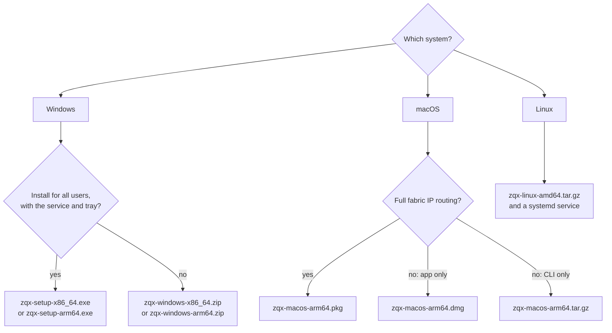

# ZQX installation and deployment guide

This guide tells how to install ZQX on Windows, macOS and Linux.

The diagram shows which download to use.



All files are on the [releases page](https://github.com/zqxnet/releases/releases/latest).

## Windows

### Option 1: setup wizard (recommended)

Download `zqx-setup-x86_64.exe` (Intel and AMD) or `zqx-setup-arm64.exe` (Windows on ARM).

**What the setup does:**
- It installs the binaries (`zqx.exe`, `zqxd.exe`, `zqx-tray.exe`, `zqx-stir.exe`) and the Wintun adapter driver, with its licence (`WINTUN-LICENSE.txt`), in `C:\Program Files\ZQX`.
- It adds `C:\Program Files\ZQX` to the system `PATH`.
- It registers and starts the Windows service `ZQXD` (`zqxd install-service`). The service restarts if it fails. The setup tells you if the service cannot start.
- It adds a Windows Firewall rule (group `ZQX`) that lets peers reach `zqxd.exe` over UDP. Thus devices can connect directly, not through the relay. Uninstallation removes the rule.
- It keeps the persistent state in `C:\ProgramData\ZQX`.
- It adds shortcuts in the Start menu and on the desktop, and starts the tray app `zqx-tray.exe`.

**Access to the service:**
- The CLI and the tray talk to the service through the protected named pipe `\\.\pipe\ProtectedPrefix\Administrators\ZQX\zqxd`.
- All logged-on users can read the status.
- Changes (`zqx up`, `zqx down`, profile changes) need a member of the Administrators group. The command prompt does not have to be elevated.
- A `zqxd.exe` that you start without elevation cannot make that pipe. Set `ZQX_PIPE` (for example `\\.\pipe\zqxd-dev`) for both `zqxd` and `zqx`.

**To add the PC to your xnet:**
1. In the console, click **Add device**.
2. Run the command in a terminal. Or copy the command, and select **Connect** from the ZQX tray icon. The tray offers to join with the copied command.

**The tray icon:**
- A green mark: connected.
- A dimmed mark: connecting.
- A grey mark: disconnected.
- Each peer in its menu can copy its IP or name, or open its web service.

**To check the service,** run `sc.exe query ZQXD` or `zqx status`. In PowerShell, use `sc.exe`, because `sc` is a different command. If the service is missing or stopped, open PowerShell as administrator and run `zqx service install`. This registers and starts the service.

### Silent installation

For Microsoft Intune, SCCM or Group Policy:

```cmd
zqx-setup-x86_64.exe /VERYSILENT /SUPPRESSMSGBOXES /NORESTART
```

### Option 2: portable archive

Download `zqx-windows-x86_64.zip` or `zqx-windows-arm64.zip`. Extract it to a directory, and run the installer script:

```powershell
powershell -ExecutionPolicy Bypass -File .\install.ps1
```

## macOS

### Option 1: installer package (recommended)

Download `zqx-macos-arm64.pkg`, and open it. The macOS Installer starts.

**What the package does:**
- It installs `ZQX.app` in `/Applications`.
- It makes links to the CLI binaries (`zqx`, `zqxd`, `zqx-stir`) in `/usr/local/bin`.
- It adds `/usr/local/bin` to the system `PATH` (`/etc/paths.d/zqx`).
- It installs the `zqxd` LaunchDaemon (`/Library/LaunchDaemons/com.zqxnet.zqxd.plist`).
  - The daemon runs as root, so that it can make the `utun` virtual adapter.
  - It starts at boot, and restarts if it stops.
  - Its log is `/var/log/zqxd.log`. The system rotates the log.
- It keeps the node identity and state in `/Library/Application Support/ZQX`. Only root can read this directory.
- It starts the menu bar app.

**Access to the daemon:** members of the `admin` group control the daemon with `zqx` and the menu bar app, through `/var/run/zqx/zqxd.sock` (`root:admin`, mode `0660`). Other users cannot connect to it.

**To check the daemon,** run `sudo launchctl print system/com.zqxnet.zqxd` or `zqx status`.

**To install from the command line:**

```bash
sudo installer -pkg zqx-macos-arm64.pkg -target /
```

### Option 2: disk image (app only)

1. Download `zqx-macos-arm64.dmg`, and open it.
2. Drag `ZQX.app` into the `Applications` folder.

The disk image does not install the LaunchDaemon. The menu bar app then starts `zqxd` as your user. This gives the SOCKS5 proxy and Fabric DNS, but `zqxd` cannot make the virtual adapter. For full fabric IP routing, use the `.pkg`.

### Option 3: command-line binaries

Download `zqx-macos-arm64.tar.gz`. Extract it, and move the binaries:

```bash
tar -xzf zqx-macos-arm64.tar.gz
sudo mv zqx zqxd zqx-stir /usr/local/bin/
```

### Uninstall from macOS

```bash
sudo zqx-uninstall           # keeps the node identity
sudo zqx-uninstall --purge   # also removes the identity, the state and the logs
```

## Linux

Download `zqx-linux-amd64.tar.gz`. Extract it, and move the binaries:

```bash
tar -xzf zqx-linux-amd64.tar.gz
sudo mv zqx zqxd zqx-stir /usr/local/bin/
```

### Run zqxd as a systemd service

Make the file `/etc/systemd/system/zqxd.service`:

```ini
[Unit]
Description=ZQX Zero-Trust Fabric Network Daemon
After=network-online.target
Wants=network-online.target

[Service]
Type=simple
ExecStart=/usr/local/bin/zqxd --state auto
Restart=always
RestartSec=5
LimitNOFILE=65536

[Install]
WantedBy=multi-user.target
```

Enable and start the service:

```bash
sudo systemctl daemon-reload
sudo systemctl enable --now zqxd
```

## Direct connections

Devices connect directly over UDP when they can. When they cannot, they connect through the ZQX relay. All functions work in both cases.

- **The peer port:** each device selects a random peer port (from 20000 to 32767) when it starts for the first time, and keeps it. Thus the port does not collide with ports that routers often use for themselves.
- **To see the port,** run `zqx netcheck`. It shows the port and how it appears outside your network.
- **On cloud machines,** let your devices receive UDP from each other. For example, add a security-group rule that permits UDP from the group itself. Or set a fixed port with `ZQX_LISTEN=0.0.0.0:<port>`, and permit that port only.

## Ping and health checks

- **`ping` reaches all peers.**
  - A peer with the virtual adapter replies from its operating system.
  - A peer without it (`--tun false`, a container, a `zqxnet` app) replies from its daemon, if the access rules permit ICMP.
- **Other whole IP packets** need the virtual adapter on both devices.
- **`zqx ping <peer>`** works from all devices. It exits with status 1 when no reply comes. Thus you can use it as a health check.
